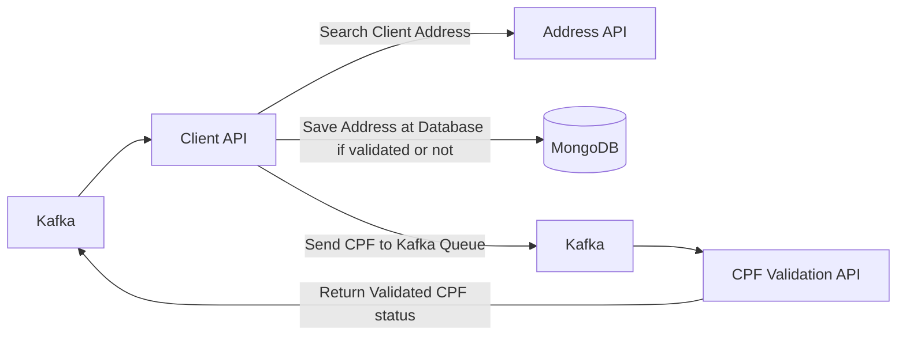

## Hexagonal Architecture (Ports and Adapters)

- [Hexagonal Introduction](#hexagonal-architecture-ports-and-adapters)
- [Project Example Structure](#project-example-structure)
- [Some personal annotations](#some-personal-annotations)

---

### Hexagonal Introduction

- The main idea is to isolate the application's core logic (business rules and use cases) from external systems, such as databases, external APIs, web interfaces, messaging systems, and frameworks. This allows the core to evolve independently of infrastructure changes.
- This isolation is achieved through ports and adapters:
    - Ports: Define contracts for communication between the application core and external systems. In Java, ports are typically represented by interfaces.
    - Adapters: Implement or use these contracts to connect the application to external technologies, such as REST controllers, database repositories, or message brokers.
- Communication occurs through two types of ports:
    - Input Ports (Driving Ports): Define how external actors can interact with the application core. An input adapter (e.g., a REST controller) receives a request and invokes an input port to execute a use case.
    - Output Ports (Driven Ports): Define how the application core interacts with external systems. The core invokes an output port, and an output adapter implements that interface to communicate with an external service (e.g., a database or API).

- Example (Java + Spring Boot)
    - Input: REST Controller → Input Port → Application Use Case
    - Output: Application Use Case → Output Port → Database Adapter → Database

```
For example, a CreateOrderUseCase receives a request through a REST controller and uses an OrderRepositoryPort to persist the order. A JpaOrderRepositoryAdapter implements that port using Spring Data JPA, keeping persistence details outside the application core.
```

---

### Project Example Structure




- /application:
    - /core: code without frameworks
        - /domain
        - /usecases: business rules
    - /ports
        - /in
        - /out

- /adapters:
    - /in
    - /out

- /config

---

## Some personal annotations

- When we'll analyse a project with Hexagonal Architecture
    - First verify the /ports to identify the core integrations with the external environment

- We can also use directories to document the meaning of the class. Ex:
    - /adapter
        - /repository
            - CustomerRepository.java
            - /mapper
                - CustomerEntityMapper.java
            - /entity
                - AddressEntity.java
                - CustomerEntity.java


- Mapper: A -> B (`Bmapper.java`)
    ```java
    @Mapper(componentModel = "spring")
    public interface BMapper {
        B toB(A a);
    }
    ```

